# Quantinuum 2021 [[7,1,3]] color code

Generated from the spec `steane` of [](api:loqs.codepacks.steane.SteaneCodepack). Do not edit: regenerate with `python -m loqs.codepacks.generator loqs.codepacks.steane:SteaneCodepack`.

## How to read this page

- Each circuit figure is a Stim timeline diagram: time runs left to right, each spec layer is one column (or several columns under a bracket when its gates overlap on the page), and each line is named by its qubit. `Imrz`, the measure-and-reset, is drawn as `MR`.
- Each element shows what LoQS does (**LoQS**: its circuit, flowchart, rows, tracking updates or hand-written source) and, where the paper has one, the paper's own figure, table or pseudocode (**Paper**) to compare it with.
- *From the paper* marks an element taken from the paper, with its citation. *Ours* marks our own choice, with its reason. *Derived* marks a statement the generator computed with Stim from the circuits and the declared logical action.
- Tracking rules read `new bit = old bit ^ old bit ...`, `^` being XOR: a gate updates the logical frame, the stored syndrome and each data qubit's Pauli frame with them. Bits not listed are unchanged.
- A flowchart shows where a hand-written apply function branches: each labelled arrow is a condition, and the instructions it leads to are the ones the function pushes onto the stack.
- [Reading a codepack spec](../markdown/codepack-specs.md) explains each element and the generated artifact.
- Paper figures adapted from [@ryananderson_realizing_2021], Phys. Rev. X 11, 041058 (2021), under CC BY 4.0: cropped, with our qubit labels added in blue.

## The code

- Data qubits: `D0`, `D1`, `D2`, `D3`, `D4`, `D5`, `D6`
- Auxiliary qubits: `A0`, `A1`, `A2`

| Stabilizer | Pauli string |
|---|---|
| `S1` | `XXXXIII` |
| `S2` | `IXXIXXI` |
| `S3` | `IIXXIXX` |
| `S4` | `ZZZZIII` |
| `S5` | `IZZIZZI` |
| `S6` | `IIZZIZZ` |

- Logical `X_L` = `IIIIXXX`, `Z_L` = `IIIIZZZ`
- Source: From the paper: [@ryananderson_realizing_2021] Fig 1
- Tracking: the logical Pauli frame is `logical_pauli_frame`, holding the bits `Z`, `X` in that order; the stored syndrome is `latest_syndrome`, one bit per stabilizer in the order above.
- Conventions: Ours: the frame's bit order and the syndrome's stabilizer order are the ones existing LoQS scripts read

**Paper:**

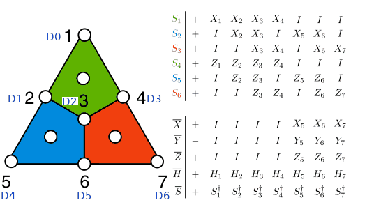

## Instructions

### Non-FT Zero Prep

A circuit of 4 layers. Role for the validation harness: prep (+Z).

From the paper: [@ryananderson_realizing_2021] Fig 10, encoding circuit. The paper leaves its wires unlabelled; ours are read top to bottom. CNOTs on disjoint qubits in neighbouring columns share a layer

**LoQS circuit:**

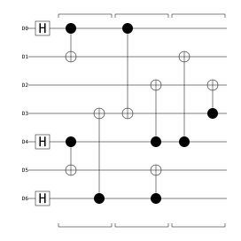

**Paper:**

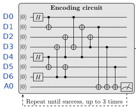

### Non-FT Zero Prep + Checks

A circuit of 8 layers.

From the paper: [@ryananderson_realizing_2021] Fig 10 and Sec II.A.1, encoding circuit and its Z_L check. Note: the check measures Z_L·S5·S6 (Z on D1, D3, D5)

**LoQS circuit:**

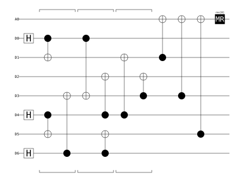

**Paper:**


### FT Zero Prep

Resets the patch with the circuit below and clears its tracking data, then runs `Non-FT Zero Prep + Checks` until it reads `A0` = 0. Role for the validation harness: prep (+Z).

Ours: the reset-then-retry loop and the default of 100 repeats; the paper repeats up to 3 times and then proceeds (see [@ryananderson_realizing_2021] Fig 10 caption, Fig 14)

**LoQS circuit:**


**LoQS flowchart:**

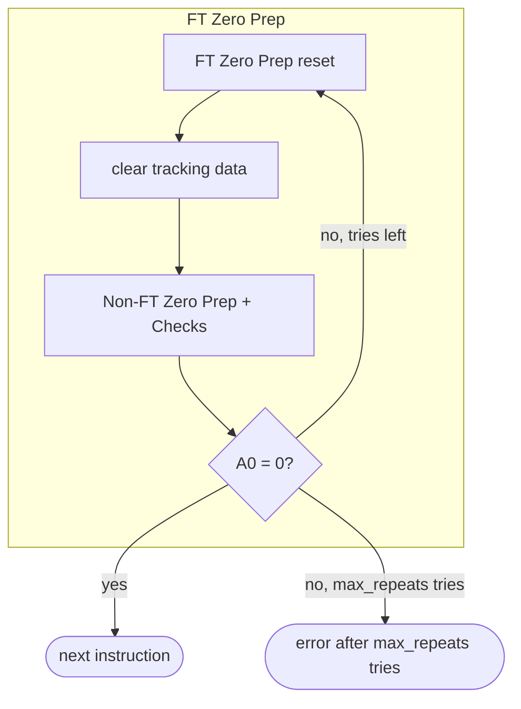

**Paper:**

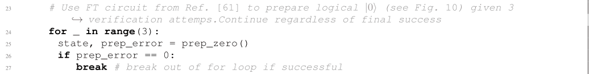

### X, Y, Z

The logical `X`, `Y`, `Z` gates, as the circuits `X`, `Y`, `Z`. Their frame and syndrome maps are the identity, so no bookkeeping step runs.

From the paper: [@ryananderson_realizing_2021] Fig 1

| Gate | Logical | LoQS circuit |
|---|---|---|
| `X` | `X` | 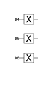 |
| `Y` | `Y` | 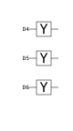 |
| `Z` | `Z` | 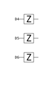 |

**Paper:**

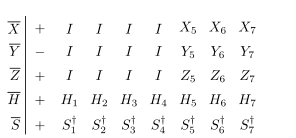

### H

The logical `H` gate, as the circuit `H Circuit`.

From the paper: [@ryananderson_realizing_2021] Fig 1

**LoQS circuit:**


**Paper:**


**LoQS tracking updates** (derived):

- new `frame.Z` = old `frame.X`
- new `frame.X` = old `frame.Z`
- new `S1` = old `S4`
- new `S2` = old `S5`
- new `S3` = old `S6`
- new `S4` = old `S1`
- new `S5` = old `S2`
- new `S6` = old `S3`
- each data qubit's Pauli frame entry maps `I`→`I`, `X`→`Z`, `Y`→`Y`, `Z`→`X` (up to sign)
- bookkeeping instruction: `H Frame Update`

### S

The logical `S` gate, as the circuit `S Circuit`.

From the paper: [@ryananderson_realizing_2021] Fig 1: logical S is S-dagger on every data qubit; frame update [@ryananderson_realizing_2021] Fig 15 (sgate2pf), matched by the derivation

**LoQS circuit:**


**Paper:**


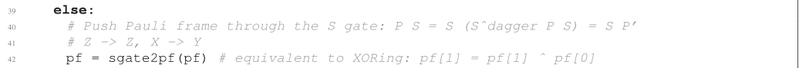

**LoQS tracking updates** (derived):

- new `frame.Z` = old `frame.Z` ^ `frame.X`
- new `S1` = old `S1` ^ `S4`
- new `S2` = old `S2` ^ `S5`
- new `S3` = old `S3` ^ `S6`
- each data qubit's Pauli frame entry maps `I`→`I`, `X`→`Y`, `Y`→`X`, `Z`→`Z` (up to sign)
- bookkeeping instruction: `S Frame Update`

### Sdag

The logical `S_DAG` gate, as the circuit `Sdag Circuit`.

Ours: the inverse of Fig 1's logical S; Fig 1 lists no S-dagger

**LoQS circuit:**


**LoQS tracking updates** (derived):

- new `frame.Z` = old `frame.Z` ^ `frame.X`
- new `S1` = old `S1` ^ `S4`
- new `S2` = old `S2` ^ `S5`
- new `S3` = old `S3` ^ `S6`
- each data qubit's Pauli frame entry maps `I`→`I`, `X`→`Y`, `Y`→`X`, `Z`→`Z` (up to sign)
- bookkeeping instruction: `S Frame Update`

### I

The logical `I` gate, as the circuit `I`. Its frame and syndrome maps are the identity, so no bookkeeping step runs.

Ours: an explicit logical idle, so a program can idle the patch

**LoQS circuit:**

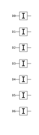

### Flagged Parallel S1-S5-S6 Check

A circuit of 9 layers. Derived: it reads `A0` as `S1`, `A1` as `S5`, `A2` as `S6`.

From the paper: [@ryananderson_realizing_2021] Fig 10, first flagged parallel circuit; auxes read S1, S5, S6 (Fig 11, Fig 17). CNOTs on disjoint qubits in neighbouring columns share a layer

**LoQS circuit:**

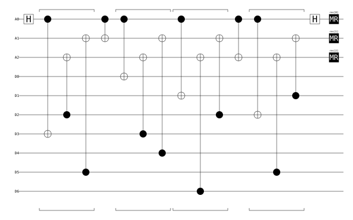

**Paper:**

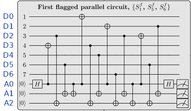

### Flagged Parallel S2-S3-S4 Check

A circuit of 9 layers. Derived: it reads `A0` as `S4`, `A1` as `S2`, `A2` as `S3`.

From the paper: [@ryananderson_realizing_2021] Fig 10, second flagged parallel circuit; auxes read S4, S2, S3 (Fig 17; the caption's {S1, S3, S4} is a typo). CNOTs on disjoint qubits in neighbouring columns share a layer

**LoQS circuit:**

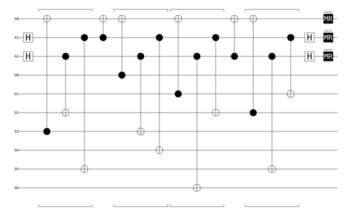

**Paper:**

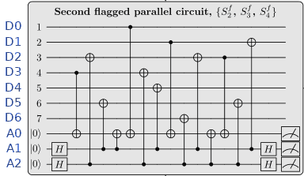

### Unflagged S1 Check … Unflagged S6 Check

Each checks one stabilizer with one auxiliary qubit; the Reads column is derived.

From the paper: [@ryananderson_realizing_2021] Fig 10, unflagged circuits: data in support order. The aux is ours: A0, A1, A2 for S1-S3 and again for S4-S6

| Check | Reads | LoQS circuit |
|---|---|---|
| `Unflagged S1 Check` | `A0` as `S1` |  |
| `Unflagged S2 Check` | `A1` as `S2` |  |
| `Unflagged S3 Check` | `A2` as `S3` | 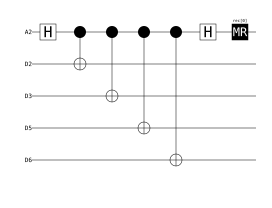 |
| `Unflagged S4 Check` | `A0` as `S4` |  |
| `Unflagged S5 Check` | `A1` as `S5` | 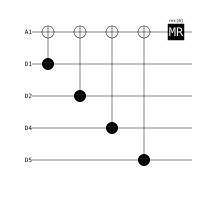 |
| `Unflagged S6 Check` | `A2` as `S6` |  |

### Unflagged Parallel S1-S2-S3 Check

The circuits `Unflagged S1 Check`, `Unflagged S2 Check`, `Unflagged S3 Check` merged layer by layer from layer 0. Derived: it reads `A0` as `S1`, `A1` as `S2`, `A2` as `S3`.

Ours: the three X checks run in parallel, one aux each (see [@ryananderson_realizing_2021] Fig 10, unflagged circuits)

**LoQS circuit:**

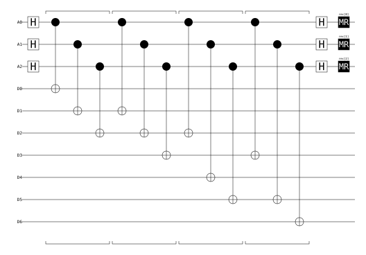

**Paper:**

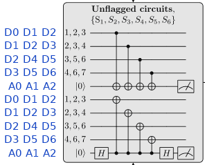

### Unflagged Parallel S4-S5-S6 Check

The circuits `Unflagged S4 Check`, `Unflagged S5 Check`, `Unflagged S6 Check` merged layer by layer from layer 0. Derived: it reads `A0` as `S4`, `A1` as `S5`, `A2` as `S6`.

Ours: the three Z checks run in parallel, one aux each (see [@ryananderson_realizing_2021] Fig 10, unflagged circuits)

**LoQS circuit:**

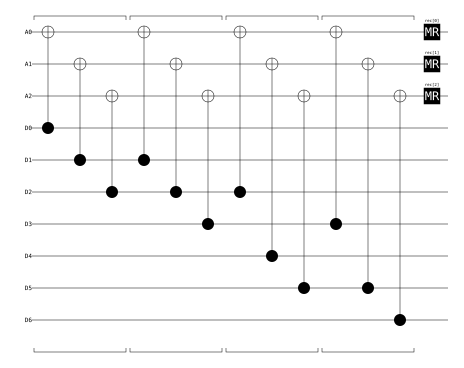

**Paper:**


### Flagged S1-S5-S6 Feed-Forward

A hand-written apply function, [`flagged_feedforward`](api:loqs.codepacks.steane.custom_apply_fns.flagged_feedforward):

- takes `flag_qubits` = `A0, A1, A2`, `first_check` = `True`
- reads the generated tables `syndrome_index:Flagged Parallel S1-S5-S6 Check`
- writes `flagged_syndrome_diff`, which a prep clears
- when a flagged reading differs from latest_syndrome: runs `Unflagged Parallel S1-S2-S3 Check`, then `Unflagged Parallel S4-S5-S6 Check`, then `QEC Decoder`
- when none differs: runs `Flagged Parallel S2-S3-S4 Check`, then `Flagged S2-S3-S4 Feed-Forward`

From the paper: [@ryananderson_realizing_2021] Sec II.A.2, Fig 10 caption, Fig 17 (first branch)

**LoQS flowchart:**

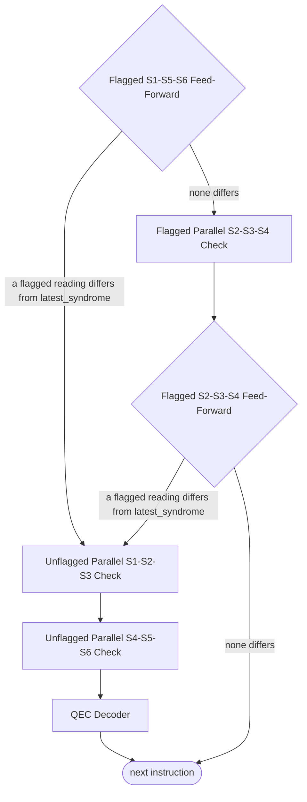

<details markdown="1">
<summary><b>LoQS source:</b> <code>flagged_feedforward</code></summary>

```python
def flagged_feedforward(
    patch_label: str,
    patches: PatchLayout,
    measurement_outcomes: MeasurementOutcomes,
    flag_qubits: list[str],
    syndrome_index: dict[str, int],
    first_check: bool,
    stack: InstructionStack,
) -> Frame:
    """PRX Sec II.A.3 steps 1a and 1b: diff the flagged readings against
    the stored syndrome; on a change run the unflagged checks and decode."""
    patch = patches[patch_label]
    last_syndromes = patch.data.get("latest_syndrome", [0] * 6)
    flag_syndrome_diff = list(patch.data.get("flagged_syndrome_diff", [0] * 6))
    for fq in flag_qubits:
        j = syndrome_index[fq]
        flag_syndrome_diff[j] = measurement_outcomes[fq][0] ^ last_syndromes[j]

    new_patch = patch.copy()
    new_patch.data["flagged_syndrome_diff"] = flag_syndrome_diff

    if any(sd == 1 for sd in flag_syndrome_diff):
        new_stack = stack.insert_instructions(
            0,
            [
                ("Unflagged Parallel S1-S2-S3 Check", patch_label),
                ("Unflagged Parallel S4-S5-S6 Check", patch_label),
                ("QEC Decoder", patch_label),
            ],
        )
    elif first_check:
        new_stack = stack.insert_instructions(
            0,
            [
                ("Flagged Parallel S2-S3-S4 Check", patch_label),
                ("Flagged S2-S3-S4 Feed-Forward", patch_label),
            ],
        )
    else:
        new_stack = stack
        new_patch.data.pop("flagged_syndrome_diff", None)

    new_patches = patches.copy()
    new_patches[patch_label] = new_patch
    return Frame(
        {
            "stack": new_stack,
            "patches": new_patches,
            "flag_syndrome_diff": flag_syndrome_diff,
        }
    )
```

</details>

**Paper:**

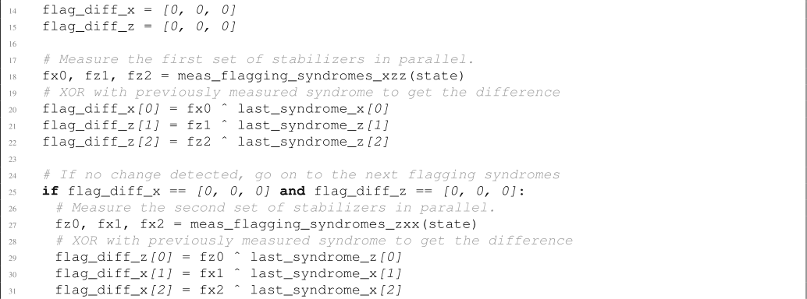

### Flagged S2-S3-S4 Feed-Forward

A hand-written apply function, [`flagged_feedforward`](api:loqs.codepacks.steane.custom_apply_fns.flagged_feedforward):

- takes `flag_qubits` = `A0, A1, A2`, `first_check` = `False`
- reads the generated tables `syndrome_index:Flagged Parallel S2-S3-S4 Check`
- writes `flagged_syndrome_diff`, which a prep clears
- when a flagged reading differs from latest_syndrome: runs `Unflagged Parallel S1-S2-S3 Check`, then `Unflagged Parallel S4-S5-S6 Check`, then `QEC Decoder`
- when none differs: runs nothing more

From the paper: [@ryananderson_realizing_2021] Sec II.A.2, Fig 10 caption, Fig 17 (second branch)

**LoQS flowchart:**

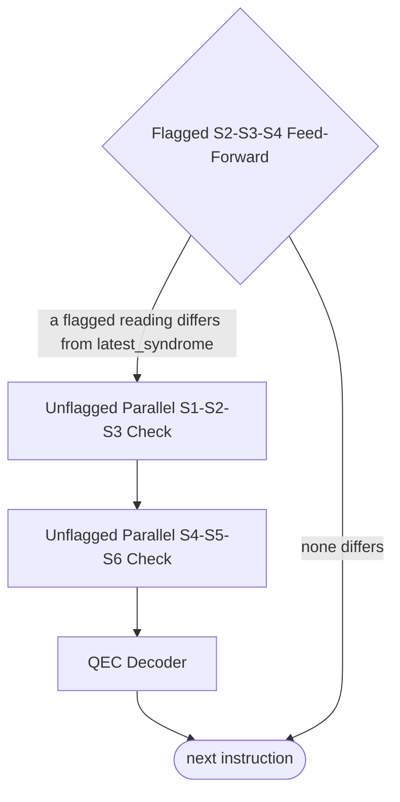

<details markdown="1">
<summary><b>LoQS source:</b> <code>flagged_feedforward</code></summary>

```python
def flagged_feedforward(
    patch_label: str,
    patches: PatchLayout,
    measurement_outcomes: MeasurementOutcomes,
    flag_qubits: list[str],
    syndrome_index: dict[str, int],
    first_check: bool,
    stack: InstructionStack,
) -> Frame:
    """PRX Sec II.A.3 steps 1a and 1b: diff the flagged readings against
    the stored syndrome; on a change run the unflagged checks and decode."""
    patch = patches[patch_label]
    last_syndromes = patch.data.get("latest_syndrome", [0] * 6)
    flag_syndrome_diff = list(patch.data.get("flagged_syndrome_diff", [0] * 6))
    for fq in flag_qubits:
        j = syndrome_index[fq]
        flag_syndrome_diff[j] = measurement_outcomes[fq][0] ^ last_syndromes[j]

    new_patch = patch.copy()
    new_patch.data["flagged_syndrome_diff"] = flag_syndrome_diff

    if any(sd == 1 for sd in flag_syndrome_diff):
        new_stack = stack.insert_instructions(
            0,
            [
                ("Unflagged Parallel S1-S2-S3 Check", patch_label),
                ("Unflagged Parallel S4-S5-S6 Check", patch_label),
                ("QEC Decoder", patch_label),
            ],
        )
    elif first_check:
        new_stack = stack.insert_instructions(
            0,
            [
                ("Flagged Parallel S2-S3-S4 Check", patch_label),
                ("Flagged S2-S3-S4 Feed-Forward", patch_label),
            ],
        )
    else:
        new_stack = stack
        new_patch.data.pop("flagged_syndrome_diff", None)

    new_patches = patches.copy()
    new_patches[patch_label] = new_patch
    return Frame(
        {
            "stack": new_stack,
            "patches": new_patches,
            "flag_syndrome_diff": flag_syndrome_diff,
        }
    )
```

</details>

**Paper:**


### QEC Decoder

A hand-written apply function, [`qec_decoder`](api:loqs.codepacks.steane.custom_apply_fns.qec_decoder):

- reads the generated tables `aux_order:Unflagged Parallel S1-S2-S3 Check`, `aux_order:Unflagged Parallel S4-S5-S6 Check`, `lut:Table 1`, `lut:Table 2`
- writes `flagged_syndrome_diff`, which a prep clears

From the paper: [@ryananderson_realizing_2021] Sec II.A.3, Tables I and II, Fig 17, Fig 11

<details markdown="1">
<summary><b>LoQS source:</b> <code>qec_decoder</code></summary>

```python
def qec_decoder(
    patch_label: str,
    patches: PatchLayout,
    X_outcomes: MeasurementOutcomes,
    Z_outcomes: MeasurementOutcomes,
    X_qubits: list[str],
    Z_qubits: list[str],
    data_lut: list[list[int]],
    hook_lut: list[list[list[int]]],
) -> Frame:
    """PRX Sec II.A.3 step 2: Table 1 on the unflagged diff, Table 2 on
    the (flagged diff, unflagged diff) pair, per check type."""
    patch = patches[patch_label]
    last_syndromes = patch.data.get("latest_syndrome", [0] * 6)
    logical_pauli_frame = list(patch.data.get("logical_pauli_frame", [0, 0]))
    flagged_syndrome_diff = patch.data.get("flagged_syndrome_diff", [None] * 6)

    unflagged_syndrome = [X_outcomes[q][0] for q in X_qubits]
    unflagged_syndrome.extend([Z_outcomes[q][0] for q in Z_qubits])
    unflagged_syndrome_diff = [
        int(i) for i in np.bitwise_xor(last_syndromes, unflagged_syndrome)
    ]

    for pf_idx, sl in ((0, slice(0, 3)), (1, slice(3, 6))):
        sd = unflagged_syndrome_diff[sl]
        fsd = list(flagged_syndrome_diff[sl])
        if sd in data_lut:
            logical_pauli_frame[pf_idx] ^= 1
        if [fsd, sd] in hook_lut:
            logical_pauli_frame[pf_idx] ^= 1

    new_patch = patch.copy()
    new_patch.data["latest_syndrome"] = unflagged_syndrome
    new_patch.data["logical_pauli_frame"] = logical_pauli_frame
    new_patch.data.pop("flagged_syndrome_diff", None)
    new_patches = patches.copy()
    new_patches[patch_label] = new_patch
    return Frame(
        {
            "unflagged_syndrome": unflagged_syndrome,
            "unflagged_syndrome_diff": unflagged_syndrome_diff,
            "flagged_syndrome_diff": flagged_syndrome_diff,
            "new_logical_pauli_frame": logical_pauli_frame,
            "patches": new_patches,
        }
    )
```

</details>

**Paper:**

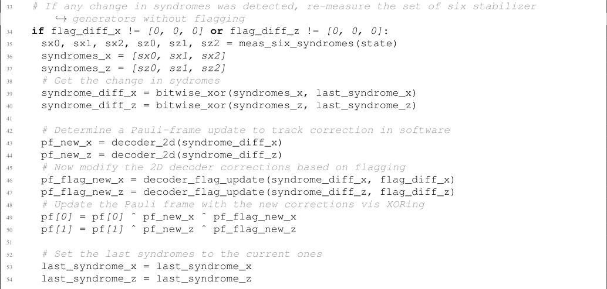

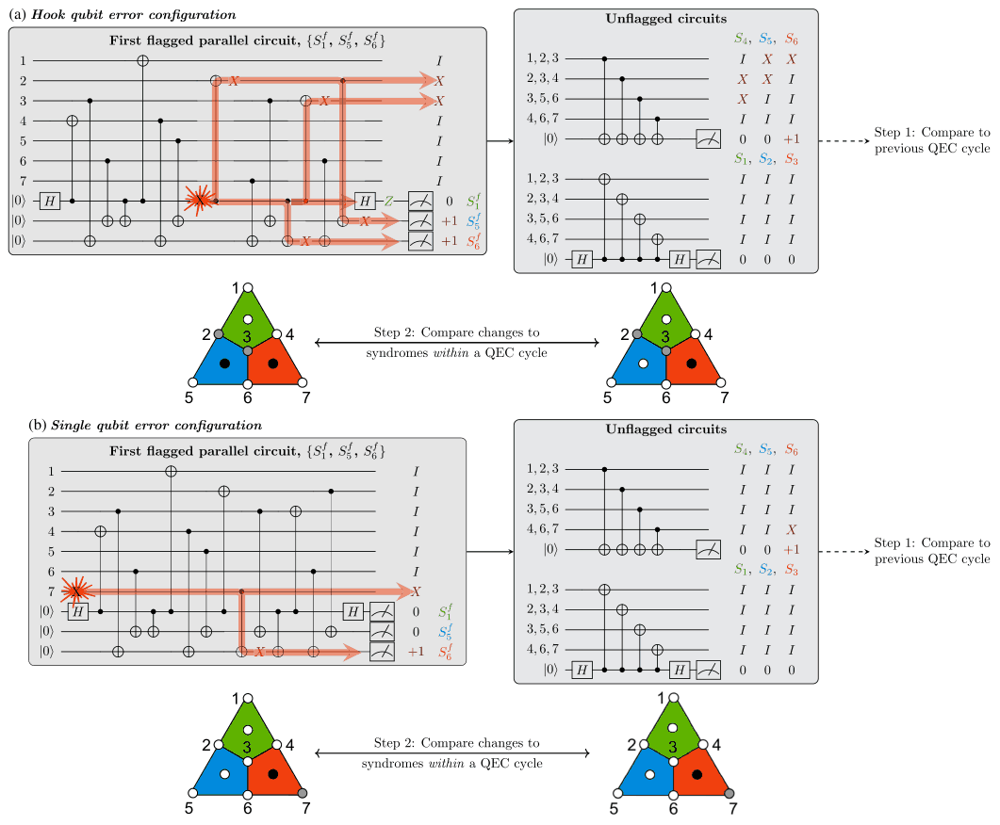

### Adaptive QEC

Runs `Flagged Parallel S1-S5-S6 Check`, then `Flagged S1-S5-S6 Feed-Forward`. Role for the validation harness: qec.

From the paper: [@ryananderson_realizing_2021] Sec II.A.2, Fig 3, Fig 10

**LoQS flowchart:**

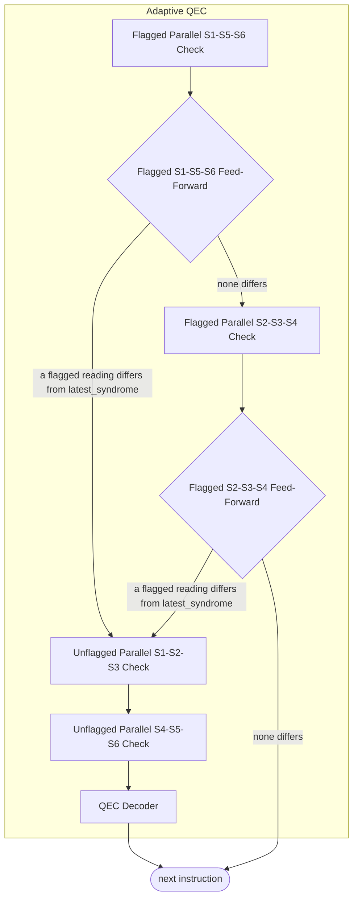

**Paper:**

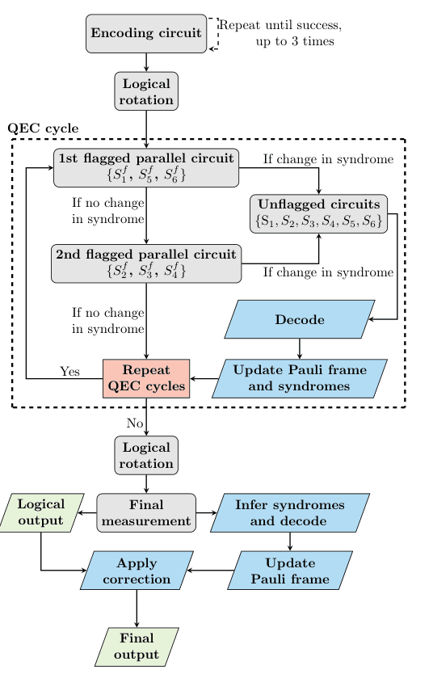

### Raw Z Data Measure

A circuit of 1 layer.

From the paper: [@ryananderson_realizing_2021] Fig 10 final measurement, Fig 19 (meas_z_data)

**LoQS circuit:**


**Paper:**

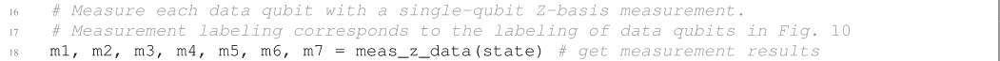

### Raw X Data Measure

A circuit of 2 layers.

Ours: every data qubit measured in X, for a program to call; the X measure uses the H Circuit and the Z readout instead

**LoQS circuit:**

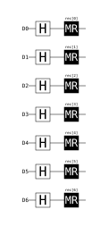

### FT Z logical parity calculation

A hand-written apply function, [`logical_parity`](api:loqs.codepacks.steane.custom_apply_fns.logical_parity):

- takes `data_qubits` = `D0, D1, D2, D3, D4, D5, D6`, `measurement_basis` = `Z`
- reads the generated tables `support:Z-type`, `logical_support:Z`, `lut:Table 1`

Ours: decode the diff against latest_syndrome, then update the frame and infer again (see [@ryananderson_realizing_2021] Sec II.A.4, Fig 19)

<details markdown="1">
<summary><b>LoQS source:</b> <code>logical_parity</code></summary>

```python
def logical_parity(
    patch_label: str,
    patches: PatchLayout,
    data_qubits: list[str],
    measurement_basis: str,
    measurement_outcomes: MeasurementOutcomes,
    checks: list[list[int]],
    readout: list[int],
    data_lut: list[list[int]],
) -> Frame:
    """PRX Sec II.A.4: raw parity of the logical's support, the checks of
    the measured type rebuilt from the data, Table 1 on their diff against
    the stored syndrome, then the frame."""
    logical_pauli_frame = list(
        patches[patch_label].data.get("logical_pauli_frame", [0, 0])
    )
    last_syndrome = patches[patch_label].data.get("latest_syndrome", [0] * 6)
    raw = [measurement_outcomes[data_qubits[i]][0] for i in readout]
    uncorrected_outcome = sum(raw) % 2
    classical_syndrome = [
        sum(measurement_outcomes[data_qubits[i]][0] for i in c) % 2
        for c in checks
    ]
    if measurement_basis == "X":
        pf_idx, last = 0, last_syndrome[:3]
    else:
        pf_idx, last = 1, last_syndrome[3:]
    diff = [c ^ s for c, s in zip(classical_syndrome, last)]
    if diff in data_lut:
        logical_pauli_frame[pf_idx] ^= 1
    return Frame(
        {
            "patch_label": patch_label,
            "logical_measurement": uncorrected_outcome
            ^ logical_pauli_frame[pf_idx],
            "uncorrected_measurement": uncorrected_outcome,
            "classical_syndrome": classical_syndrome,
            "classical_syndrome_diff": diff,
            "final_logical_pauli_frame": logical_pauli_frame,
        }
    )
```

</details>

**Paper:**

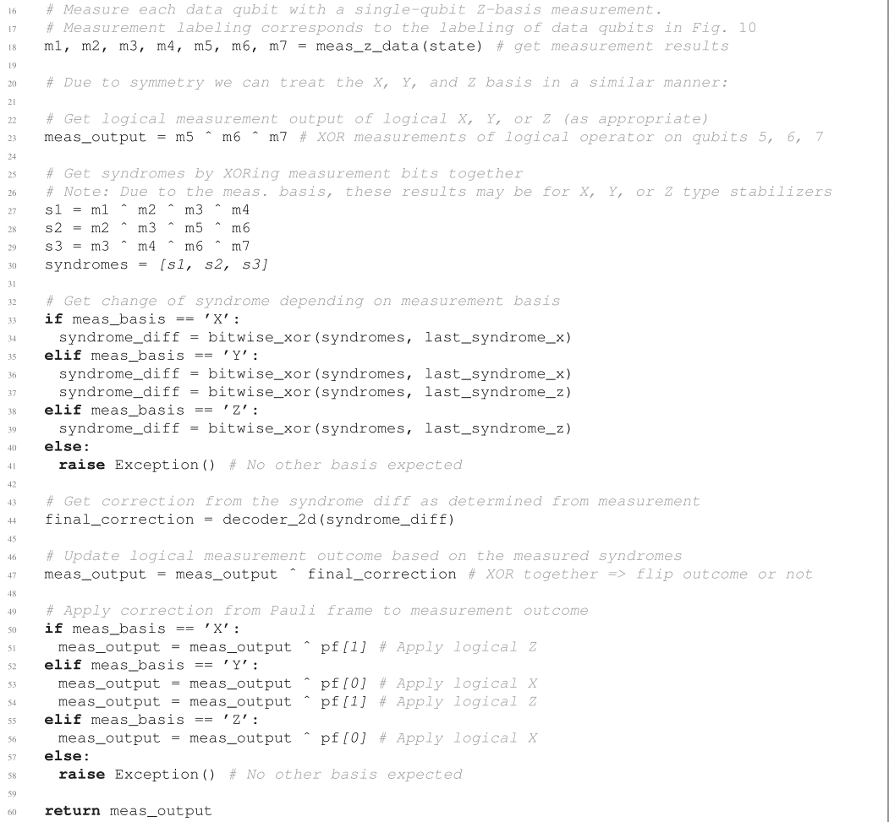

### FT X logical parity calculation

A hand-written apply function, [`logical_parity`](api:loqs.codepacks.steane.custom_apply_fns.logical_parity):

- takes `data_qubits` = `D0, D1, D2, D3, D4, D5, D6`, `measurement_basis` = `X`
- reads the generated tables `support:X-type`, `logical_support:X`, `lut:Table 1`

Ours: decode the diff against latest_syndrome, then update the frame and infer again (see [@ryananderson_realizing_2021] Sec II.A.4, Fig 19)

<details markdown="1">
<summary><b>LoQS source:</b> <code>logical_parity</code></summary>

```python
def logical_parity(
    patch_label: str,
    patches: PatchLayout,
    data_qubits: list[str],
    measurement_basis: str,
    measurement_outcomes: MeasurementOutcomes,
    checks: list[list[int]],
    readout: list[int],
    data_lut: list[list[int]],
) -> Frame:
    """PRX Sec II.A.4: raw parity of the logical's support, the checks of
    the measured type rebuilt from the data, Table 1 on their diff against
    the stored syndrome, then the frame."""
    logical_pauli_frame = list(
        patches[patch_label].data.get("logical_pauli_frame", [0, 0])
    )
    last_syndrome = patches[patch_label].data.get("latest_syndrome", [0] * 6)
    raw = [measurement_outcomes[data_qubits[i]][0] for i in readout]
    uncorrected_outcome = sum(raw) % 2
    classical_syndrome = [
        sum(measurement_outcomes[data_qubits[i]][0] for i in c) % 2
        for c in checks
    ]
    if measurement_basis == "X":
        pf_idx, last = 0, last_syndrome[:3]
    else:
        pf_idx, last = 1, last_syndrome[3:]
    diff = [c ^ s for c, s in zip(classical_syndrome, last)]
    if diff in data_lut:
        logical_pauli_frame[pf_idx] ^= 1
    return Frame(
        {
            "patch_label": patch_label,
            "logical_measurement": uncorrected_outcome
            ^ logical_pauli_frame[pf_idx],
            "uncorrected_measurement": uncorrected_outcome,
            "classical_syndrome": classical_syndrome,
            "classical_syndrome_diff": diff,
            "final_logical_pauli_frame": logical_pauli_frame,
        }
    )
```

</details>

**Paper:**


### FT Logical Z Measure

Runs `Raw Z Data Measure`, then `FT Z logical parity calculation`. Role for the validation harness: measure (Z).

From the paper: [@ryananderson_realizing_2021] Sec II.A.4, Fig 19

**LoQS flowchart:**

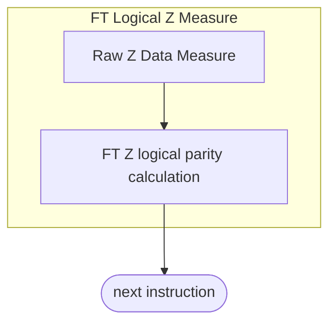

**Paper:**


### FT Logical X Measure

Runs `H Circuit`, then `Raw Z Data Measure`, then `FT X logical parity calculation`. Role for the validation harness: measure (X).

From the paper: [@ryananderson_realizing_2021] Sec II.A.4, Fig 18 (rotate_meas_basis): logical H, then the Z readout

**LoQS flowchart:**

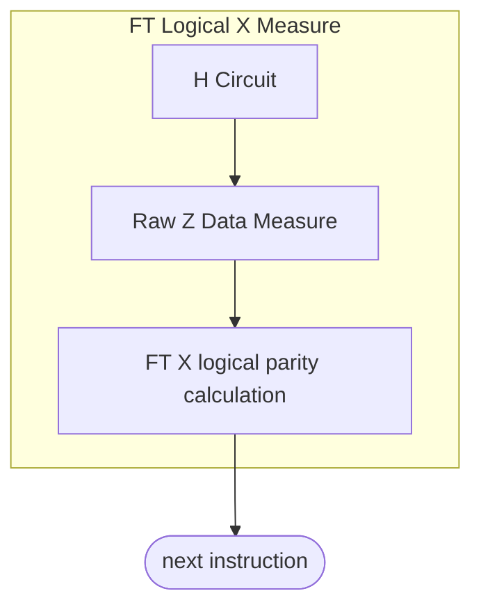

**Paper:**

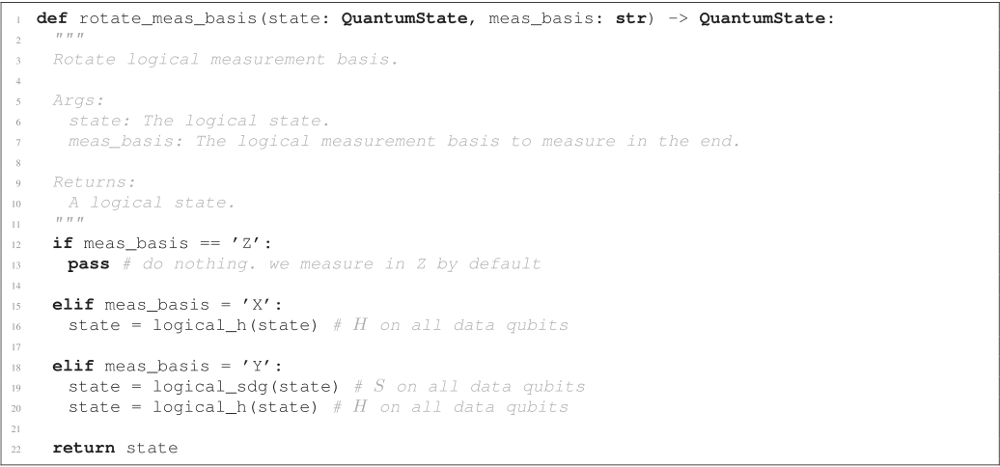

## Lookup tables

### Table 1

A data table of 3 rows. From the paper: [@ryananderson_realizing_2021] Table I (= Fig 21 decoder_2d), its +1/-1 rows as 0/1 bits

**LoQS rows:**

- `[0, 0, 1]`
- `[0, 1, 0]`
- `[0, 1, 1]`

**Paper:**

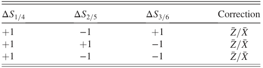

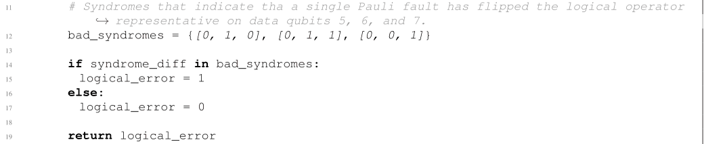

### Table 2

A flag table of 3 rows. From the paper: [@ryananderson_realizing_2021] Table II (= Fig 22 decoder_flag_update), rows as bits

**LoQS rows:**

- `[[1, 0, 0], [0, 1, 0]]`
- `[[1, 0, 0], [0, 0, 1]]`
- `[[0, 1, 1], [0, 0, 1]]`

**Paper:**

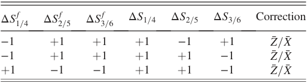

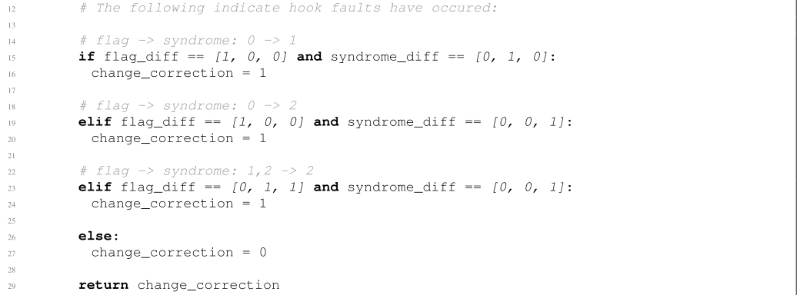

## Two-patch gates

### Transversal CX

The logical `CX` gate across the patches `ctrl`, `tgt`.

Ours: the textbook transversal CNOT; the paper has no logical two-qubit gate (see [@ryananderson_realizing_2021] Sec I)

**LoQS circuit:**

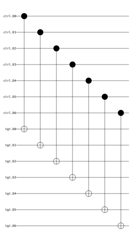

**LoQS joint tracking updates** (derived):

- new `ctrl.frame.Z` = old `ctrl.frame.Z` ^ `tgt.frame.Z`
- new `tgt.frame.X` = old `ctrl.frame.X` ^ `tgt.frame.X`
- new `ctrl.S1` = old `ctrl.S1` ^ `tgt.S1`
- new `ctrl.S2` = old `ctrl.S2` ^ `tgt.S2`
- new `ctrl.S3` = old `ctrl.S3` ^ `tgt.S3`
- new `tgt.S4` = old `ctrl.S4` ^ `tgt.S4`
- new `tgt.S5` = old `ctrl.S5` ^ `tgt.S5`
- new `tgt.S6` = old `ctrl.S6` ^ `tgt.S6`
